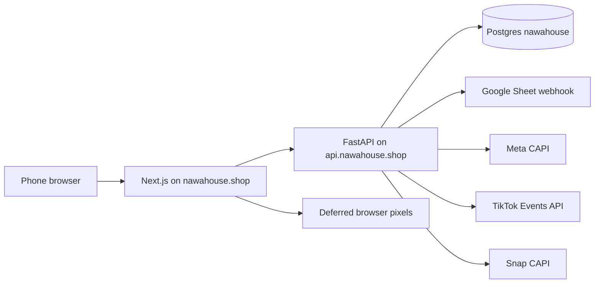
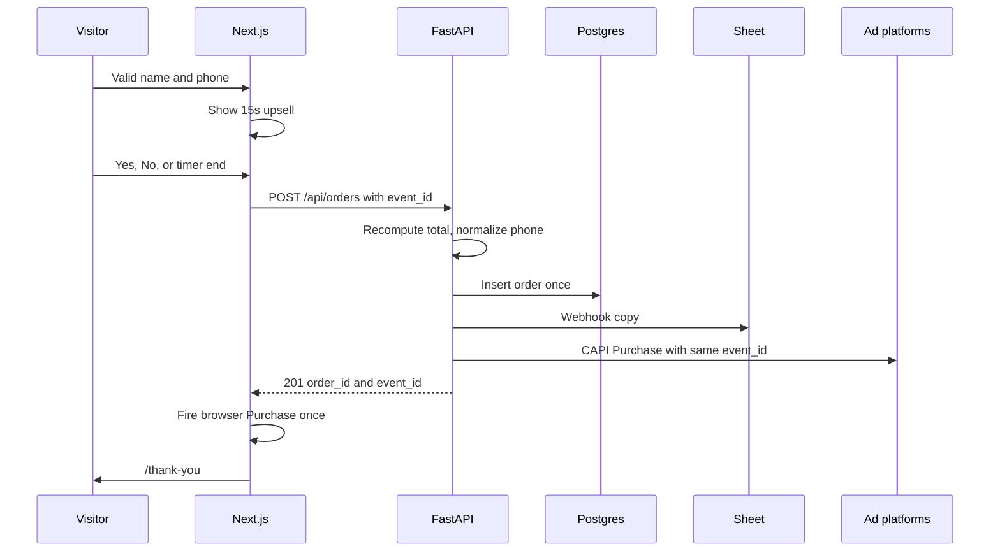

# Architecture

## Shape

The browser never holds the sheet URL, the CAPI tokens, or the database URL. Those live in the backend environment on EasyPanel.

## Responsibilities

| | Frontend | Backend |
|---|---|---|
| Pages, RTL, cart UI | yes | no |
| Price display | mirrors the formula | owns the formula |
| Saudi phone check | immediate, for the button | again, before insert |
| Pixels | deferred, unhashed | no |
| CAPI | no | hashed, server |
| Order row | no | yes |
| Sheet row | no | yes |
| Migrations | no | on process start |

## Order path

Sheet or CAPI failure does not roll back a saved order. Log the failure on the order row and return 201. The operator can replay from the database. A database failure returns 503 and the browser does not fire Purchase.

## Event path for non-purchase

ViewContent, AddToCart, and InitiateCheckout are fired in the browser and also `POST /api/events` so the server can forward CAPI. The same `event_id` is on both sides. Purchase is not sent through `/api/events`. It is sent only inside order creation, so a refresh cannot mint a second purchase on the server.

## Identity cookies

First visit, the frontend sets first-party cookies, 90 days, `SameSite=Lax`, `Secure` in production:

- `nawa_eid`: random UUID, the external id seed
- `nawa_sc_cid`: value of query `ScCid` if present

Also read, do not overwrite, the platform cookies `_fbp`, `_fbc`, `_ttp`, and `_scid`.

If the landing URL has `fbclid` and `_fbc` is missing, set `_fbc` to `fb.1.{timestampMs}.{fbclid}`.

Persist `ttclid` from the query into `nawa_ttclid` for 28 days.

Send these values with the order and with `/api/events`. The backend forwards them unhashed, except `nawa_eid`, which is SHA-256 hashed before it is sent as `external_id`.

## Idempotency

- `orders.client_event_id` is unique. A retry of the same checkout returns the original order and does not insert, does not append a second sheet row, and does not send a second CAPI purchase.
- `tracking_events.event_id` + `event_name` is unique. Replays no-op.

## Security

- CORS allows `https://nawahouse.shop` only.
- Rate limit `POST /api/orders` to 8 requests per IP per hour and 3 successful orders per phone per 24 hours.
- No account system, no admin UI in the MVP. Status changes happen in the sheet and, if needed later, in SQL.
- Do not log full phone numbers in application logs. Log the last 4 digits.

## Out of scope

Stripe, Mada, Apple Pay, login, wishlist, search index, CMS, WhatsApp API, SMS OTP, inventory sync with a supplier, multi-language, and a public `/cart` page.
